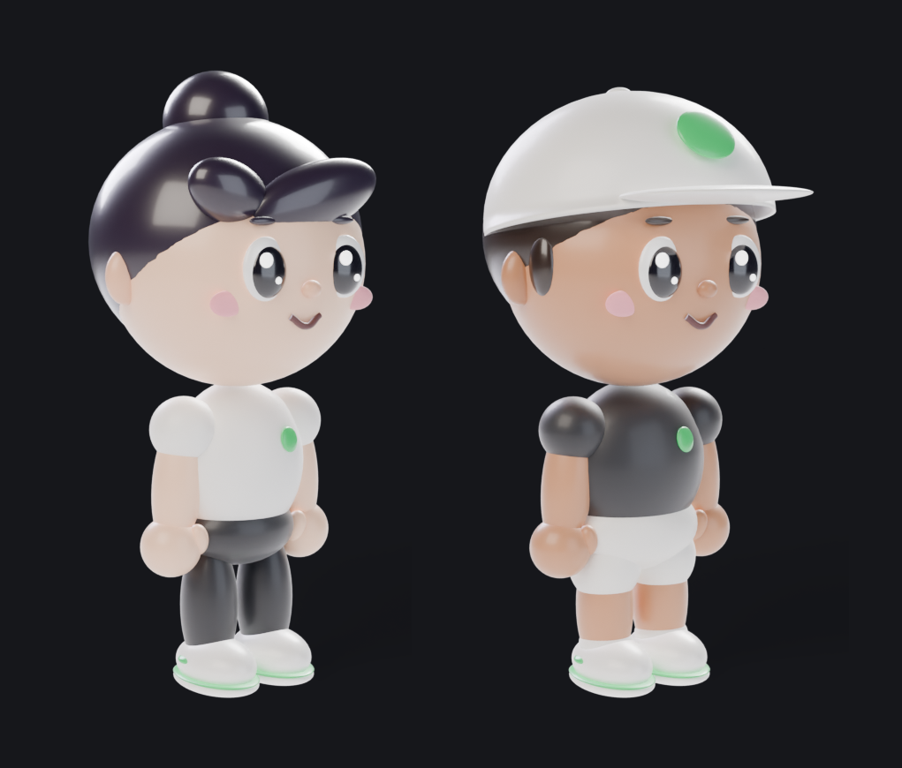

# Tracko characters

Two playful characters, female and male, who act out the onboarding story: lifting, logging the set, and celebrating when the number goes up. They're built from one recipe, so they always match. Since v0.2 they have a glossy vinyl-toy finish, like the Any Distance mascot the owner pointed to (`design/references/005`, `006`).



## Files

| File | What it is |
|---|---|
| `cast.png` | Both characters side by side, on the app's ink background |
| `female/sheet.png`, `male/sheet.png` | Character sheets: front, three-quarter, side and back, plus the four expressions |
| `female/gym-log-preview.mp4`, `male/gym-log-preview.mp4` | The gym log clip on ink, with the +7% pop-up drawn in, for reviewing |
| `female/gym-log.webm`, `male/gym-log.webm` | The same clip with a transparent background and no pop-up: the master for the app |
| `gym-log-timing.json` | Frame and second marks for each beat; the app syncs its overlay (the +% pop-up) to `popup` |
| `build/` | The Blender script that builds and animates the characters, and the render pipeline |
| `../Tracko/Assets.xcassets/Onboarding/` | The onboarding heroes, rendered by `render_all.py heroes` (see below) |

## Onboarding heroes

Each onboarding page has a diorama: the characters on a round platform, beside a giant phone for the pages that show the app. All heroes share one camera and one platform, so the stage holds still while the pages swipe. Matched to the reference by measurement: the platform spans 82% of the image width and the phone 32%, centred; the camera sits about 5° above the platform and frames with lens shift; the platform and phone frame colours match the reference's.

| Hero | Characters | Faces |
|---|---|---|
| `hero-welcome` | Both, waving | happy |
| `hero-log-a`, `-b` | She reaches for the phone | surprised, then happy |
| `hero-beat-a`, `-b` | He does a lateral raise | effort, then happy |
| `hero-grow` | Both celebrating | happy |

The phone's screen is left dark: the app draws its live screen there, at the rectangle the pipeline writes into `Tracko/Onboarding/HeroRender.swift`, so the numbers come from `LiftMath` and follow the user's units. The `-a`/`-b` pairs are the same shot with a different face; the app swaps them when its moment lands.

**Idle expressions.** Each smiling face also has an `-open` render (a calm, open-eyed smile) and a `-blink` render (lids closed), and the surprised face has `hero-log-a-blink`. The app cuts between them to make the characters blink every few seconds and ease from a laugh into a smile, very subtly, and never with Reduce Motion. Render just these with `render_all.py heroes hero-grow-open hero-grow-blink …`.

## The gym log clip

The clip still has the v0.1 look (pastel clothes, smaller eyes); re-render it with `anim` and `post` to update it.


8 seconds at 24 fps (192 frames):

| Frames | Beat |
|---|---|
| 1–36 | Walks in from the left |
| 36–44 | Stops, turns to the camera |
| 44–58 | Looks at their hands; dumbbells pop in |
| 58–118 | Three lateral raises, straining (`> <` eyes) at the top of each |
| 118–146 | Dumbbells away; phone out; taps the set in |
| 148 | **The +% pops up** (drawn by the app); they look up, surprised |
| 152–172 | Crouches, jumps with arms up, happy |
| 172–192 | Lands and bounces happily to the end |

The pop-up isn't rendered into the transparent clip, because its number has to come from `LiftMath`. The preview shows "+7%".

## Style rules

- **Chibi vinyl toy.** The head is about 40% of the height, the limbs are short and rounded, and every part is a smooth rounded shape under a glossy clear coat, like a collectible figure.
- **Faces stay simple.** Big glossy eyes with a thin white rim and two sparkles, pink blush, a small nose, a line smile. Expressions swap instantly rather than morphing: neutral, effort (`> <`), surprised, happy (`^ ^`), and blinks (closed lids curving down) for the idle animation.
- **The two characters differ only in their spec:** skin, hair (bun with a side fringe, or a quiff under a cap), outfit (leggings, or shorts and socks) and build. Proportions, faces and poses are shared, so any new shot works for both.
- **Black, white and brand green.** They mirror each other: she wears a white top and black leggings, he a black top and white shorts with a white cap. Brand green appears only in small details (hair tie, chest badge, cap badge, midsoles). No red (red is reserved for trained muscles) and no yellow (targets).
- **Props are oversized** (dumbbells, kettlebell, bumper plate, bottle, a giant phone) so they read at onboarding size.
- **Lit for the dark app.** A warm key, a cool fill, a warm side light, a brand-green glow from behind and above (kept off the platform with light linking), and cool rims.

## Re-rendering and adding clips

You need Blender 4.5 LTS, Pillow and ffmpeg (libx264, libvpx-vp9).

```
python3 characters/build/render_all.py stills   # sheets and cast.png
python3 characters/build/render_all.py anim     # clip frames (about 25 min per character on 4 cores)
python3 characters/build/render_all.py post     # preview .mp4, transparent .webm, timing.json
python3 characters/build/render_all.py heroes   # onboarding heroes -> the app's asset catalog (about 3 min each)
```

Set `BLENDER=/path/to/blender` if it isn't at the default path. To change a character, edit `SPECS` in `build/tracko_characters.py`. To add a clip, write another `animate_…` function next to `animate_gym_log`, using the same pose helpers (`set_arm`, `set_leg`, `key_expression`).

## Using a clip in the app

iOS plays transparent video as HEVC with alpha. On a Mac:

```
ffmpeg -c:v libvpx-vp9 -i female/gym-log.webm -c:v hevc_videotoolbox -alpha_quality 0.75 -tag:v hvc1 female/gym-log.mov
```

Play it with `AVPlayer` in a transparent `AVPlayerLayer`, and draw the +% pop-up in SwiftUI at `popup` from `gym-log-timing.json`. These renders are 640 px, which is enough for a stage about 300 pt wide; for final quality, re-render at 1080 px with more samples on a faster machine.
